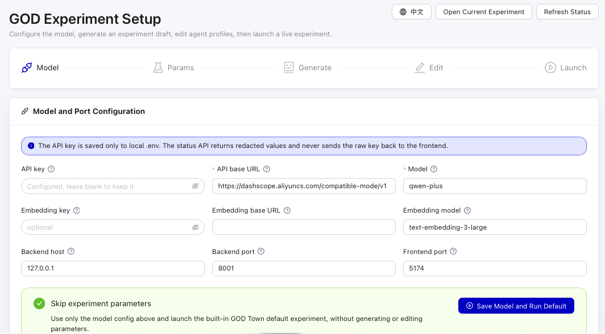

# GOD Quick Start

The shortest path from a clean machine to the setup wizard and then a live GOD control room.

> Chinese version: [QUICKSTART.zh-CN.md](QUICKSTART.zh-CN.md)

---

## 1. Prerequisites

You will need:

- macOS/Linux: Python 3.11+, Node.js & `npm`, [`uv`](https://docs.astral.sh/uv/), and `screen`
- Windows: PowerShell 5.1+ and `winget`; the startup script installs missing Git, Node.js LTS/npm, and `uv`

macOS:

```bash
brew install python node uv screen
```

If `git clone` is not available on Windows yet, install Git first with `winget install --id Git.Git -e --accept-package-agreements --accept-source-agreements` or download the repository ZIP.

## 2. Clone

```bash
git clone https://github.com/XiaoLuoLYG/GOD.git
cd GOD
```

## 3. Start

macOS/Linux:

```bash
./scripts/god.sh start
```

Windows PowerShell:

```powershell
.\scripts\god.cmd start
```

`start` is the normal one-command path. It is idempotent, so running it again reuses services that are already up.

If you are updating a running JiuwenClaw-based installation, run `stop` before updating your checkout. The first launch on JiuwenSwarm reuses your existing named runtime workspace and copies its agent data into the new layout.

On first run, GOD will:

1. Create `.env` from `.env.example`.
2. Install Python + Node dependencies.
3. Start the setup backend/control room.
4. Open the browser setup wizard at `/setup`.
5. Wait for you to save model settings and choose an experiment.
6. Bring up the full stack for that current experiment, create a live session, run the first step, and open the control room.

<p align="center">
  
</p>


In the wizard you can choose one of three paths:

- **Open GOD Town** launches the built-in The Ville baseline.
- **Open PKU Trump Visit** launches the built-in PKU campus experiment.
- **Create Custom Experiment** lets you describe a scenario, generate an editable experiment draft, adjust agents/steps, and then click **Save and Launch**.

Three settings are required:

| Variable | Example |
| --- | --- |
| `GOD_LLM_API_KEY` | `sk-...` |
| `GOD_LLM_API_BASE` | `https://api.openai.com/v1` |
| `GOD_LLM_MODEL` | `gpt-5.4` |

Any OpenAI-compatible endpoint works. The API key is saved only in local `.env`; the browser only receives redacted status. Experiment selection is saved separately in `.god/current_experiment.json`, so `.env` does not control which map or experiment starts.

To switch between built-in experiments or create another experiment later, run:

```bash
./scripts/god.sh configure
```

## 4. Open the control room

When startup finishes, the script opens the control room for the current experiment and prints a URL like:

```text
http://127.0.0.1:5174/pixel-replay/god_town/1
```

If the browser did not open automatically, open that URL. You should see the pixel town, the resident roster, step controls, and the live console.

## 5. Verify

```bash
./scripts/god.sh status
```

The backend and control room should be `up`. JiuwenClaw services are needed when a resident uses JiuwenClaw for skill selection or Ask.

### Choose an agent backend

Set `agent_backend` in the current experiment's `init/init_config.json`. A resident can override it with `kwargs.brain`. GOD then falls back to the local `GOD_AGENT_BACKEND` setting and finally to `jiuwenclaw`. Existing `JiuwenClawAgent` records can use any backend through these settings.

```json
{
  "agent_backend": {"type": "jev", "ask_backend": "openai_compat"}
}
```

| Backend | Local settings | Capabilities |
| --- | --- | --- |
| `jiuwenclaw` | Standard GOD model settings | Skill selection and Ask |
| `openai_compat` | `GOD_LLM_API_BASE`, `GOD_LLM_API_KEY`, `GOD_LLM_MODEL` | Skill selection and Ask |
| `command` | `GOD_AGENT_COMMANDS`, a JSON object mapping profile names to argument arrays | Skill selection and Ask |
| `jev` | `TYPESAFE_API_KEY` | Skill selection |
| `decision_api` | `GOD_DECISION_API_URL`, `GOD_DECISION_API_KEY`, `GOD_DECISION_MODEL` for a System One-compatible endpoint | Skill selection |
| `openai_decisions` | `OPENAI_API_KEY` for the OpenAI Decisions endpoint, or `GOD_OPENAI_DECISIONS_URL` and `GOD_OPENAI_DECISIONS_API_KEY` for a compatible endpoint | Skill selection |

The choice-only backends receive mounted skills that have no required arguments. Pair them with an Ask backend using `ask_backend` or the local default `GOD_AGENT_ASK_BACKEND`. GOD runs the selected skill and records `decision_backend` and any fallback in the run data.

Keep provider URLs, keys and command arguments in the local `.env`. A `command` backend such as `{"type":"command","profile":"local-agent"}` selects a profile from that machine's `GOD_AGENT_COMMANDS`. The trusted wrapper reads the prompt from stdin and writes a skill decision object with `selected_skill_id` and `args`, or a plain-text Ask answer, to stdout. Configure wrappers with tools disabled when they only need to select or answer.

Run `./scripts/god.sh restart` after changing the backend settings.

## 6. Restart or run fresh

Use `restart` when you want a clean process restart without wiping the current run:

```bash
./scripts/god.sh restart
```

Use `new-run` when the UI shows old replay data or you want a fresh live session:

```bash
./scripts/god.sh new-run
```

`new-run` prints the current experiment run directory, stops services, wipes only that current run state, and starts a clean live session.

## 7. Day-to-day commands

```bash
./scripts/god.sh start     # idempotent; reuses running services
./scripts/god.sh setup     # install/check dependencies only
./scripts/god.sh configure # switch built-in experiments or create a custom one
./scripts/god.sh restart   # stop everything cleanly, then start again
./scripts/god.sh new-run   # wipe the current experiment run and start fresh
./scripts/god.sh status    # print URLs, ports, and model status
./scripts/god.sh stop      # stop everything
./scripts/god.sh tail      # follow logs
./scripts/god.sh open      # open the frontend pages in the browser
```

On Windows, replace `./scripts/god.sh` with `.\scripts\god.cmd`.
