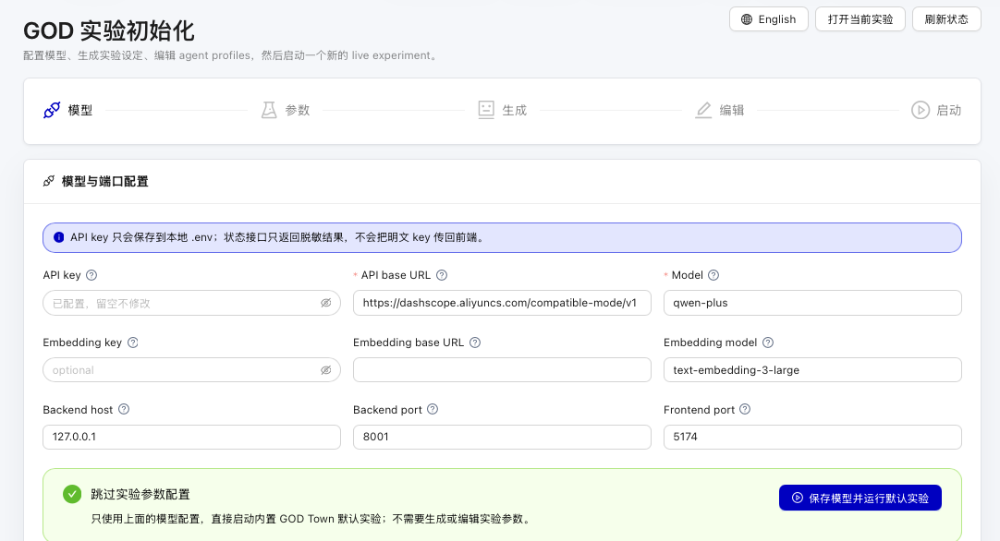

# GOD 快速开始

从一台干净机器进入配置向导，再跑到 GOD 控制台所需的最短路径。

> English: [QUICKSTART.md](QUICKSTART.md)

---

## 1. 前置依赖

需要安装：

- macOS/Linux：Python 3.11+、Node.js 与 `npm`、[`uv`](https://docs.astral.sh/uv/) 和 `screen`
- Windows：PowerShell 5.1+ 和 `winget`；启动脚本会补齐缺失的 Git、Node.js LTS/npm 与 `uv`

macOS：

```bash
brew install python node uv screen
```

Windows 如果还不能执行 `git clone`，先运行 `winget install --id Git.Git -e --accept-package-agreements --accept-source-agreements` 安装 Git，或直接下载仓库 ZIP。

## 2. 克隆

```bash
git clone https://github.com/XiaoLuoLYG/GOD.git
cd GOD
```

## 3. 启动

macOS/Linux：

```bash
./scripts/god.sh start
```

Windows PowerShell：

```powershell
.\scripts\god.cmd start
```

`start` 是日常使用的一键入口；它可以重复执行，已经运行的服务会被复用。

如果正在使用内置 JiuwenClaw 的旧版 GOD，请在更新代码前先运行 `stop`。升级到 JiuwenSwarm 后，首次启动会沿用原有的运行时实例工作区，并将其中的智能体数据复制到新目录。

第一次运行会自动完成：

1. 从 `.env.example` 创建 `.env`。
2. 安装 Python 和 Node 依赖。
3. 启动 setup 模式的后端/控制台。
4. 在浏览器打开 `/setup` 配置向导。
5. 等你保存模型配置，并选择要打开的实验。
6. 为这个当前实验启动完整栈，创建 live session，先跑完第 1 步，并打开控制台。

<p align="center">
  
</p>


向导里有三条路径：

- **打开 GOD Town**：直接启动内置 The Ville 小镇实验。
- **打开 PKU Trump Visit**：直接启动内置北大校园实验。
- **新建自定义实验**：填写场景，生成可编辑实验草案，调整 agent/steps，最后点击 **保存并启动**。

必需的三个配置：

| 变量 | 示例 |
| :-- | :-- |
| `GOD_LLM_API_KEY` | `sk-...` |
| `GOD_LLM_API_BASE` | `https://api.openai.com/v1` |
| `GOD_LLM_MODEL` | `gpt-5.4` |

任意 OpenAI 兼容接口都可以。API key 只保存在本地 `.env`；浏览器只会拿到脱敏后的状态。实验选择单独保存在 `.god/current_experiment.json`，所以 `.env` 不再控制启动哪个实验或哪张地图。

之后如果想切换两个内置实验，或创建另一个实验，运行：

```bash
./scripts/god.sh configure
```

## 4. 打开控制台

启动完成后，脚本会自动打开当前实验的控制台，并打印类似这样的 URL：

```text
http://127.0.0.1:5174/pixel-replay/god_town/1
```

如果浏览器没有自动打开，手动打开这个 URL。你应该能看到像素小镇、居民列表、step 控制条和实时控制台。

## 5. 验证

```bash
./scripts/god.sh status
```

后端和控制台应显示 `up`。当有居民用九问选择技能或回答 Ask 时，才需要九问服务。

### 选择 Agent 后端

运行 `./scripts/god.sh configure`（Windows 用 `.\scripts\god.cmd configure`）。在 Setup Wizard 的「模型」页把「默认居民运行时」设为 Codex。向导会检查本机登录状态。首次使用时，先安装 CLI，再在终端运行 `codex login`。保留 GOD 的 API 配置，用于实验草案和全局摘要。接着点「保存并继续当前实验」，或点「保存并选择实验」启动另一个实验。[安装 Codex CLI](https://learn.chatgpt.com/docs/codex/cli)

仿真推进时，居民收到的消息、环境变化和待处理的干预会发到该居民的 Codex 会话。点名 Ask 也会发到同一个会话。Codex 保存对话历史，GOD 继续保存世界状态、技能记忆和回放，并把上一轮技能执行结果带回会话。`restart` 会续接当前 run 的会话，`new-run` 会开始新的会话。对于实验中关闭记忆的居民，Codex 每次使用临时会话。

实验可在 `init/init_config.json` 中用 `agent_backend` 覆盖向导默认值，单个居民还可以用 `kwargs.brain` 覆盖实验设置。已有的 `JiuwenClawAgent` 记录同样适用。

```json
{
  "agent_backend": {"type": "jev", "ask_backend": "openai_compat"}
}
```

| 后端 | 本机配置 | 能力 |
| --- | --- | --- |
| `jiuwenclaw` | GOD 的常规模型配置 | 技能选择和 Ask |
| `codex` | 本机 Codex 登录 | 独立的居民会话，接收世界消息、干预和点名 Ask |
| `openai_compat` | `GOD_LLM_API_BASE`、`GOD_LLM_API_KEY`、`GOD_LLM_MODEL` | 技能选择和 Ask |
| `command` | `GOD_AGENT_COMMANDS`，用 JSON 对象把命令配置名映射到参数数组 | 技能选择和 Ask |
| `jev` | `TYPESAFE_API_KEY` | 技能选择 |
| `decision_api` | 兼容 System One 的 `GOD_DECISION_API_URL`、`GOD_DECISION_API_KEY`、`GOD_DECISION_MODEL` | 技能选择 |
| `openai_decisions` | 官方接口用 `OPENAI_API_KEY`，兼容接口用 `GOD_OPENAI_DECISIONS_URL` 和 `GOD_OPENAI_DECISIONS_API_KEY` | 技能选择 |

只做决策的后端从已挂载且没有必填参数的技能里选。可以通过 `ask_backend` 或本机的 `GOD_AGENT_ASK_BACKEND` 单独指定问答后端。GOD 执行技能，并在运行记录中保存 `decision_backend` 和是否触发后备选择。

把服务地址、密钥和命令参数留在本机 `.env`。例如 `{"type":"command","profile":"local-agent"}` 会从本机的 `GOD_AGENT_COMMANDS` 选择命令。受信任的包装脚本从 stdin 读提示词，从 stdout 输出含 `selected_skill_id` 和 `args` 的 JSON，或输出 Ask 的纯文本答案。只需选择和问答时，在包装脚本中禁用工具。

更改后端设置后，运行 `./scripts/god.sh restart`。

## 6. 重启或重新开跑

如果只是想干净重启进程，但保留当前 run：

```bash
./scripts/god.sh restart
```

如果 UI 里还显示旧的 replay 数据，或你想开一个全新的 live session：

```bash
./scripts/god.sh new-run
```

`new-run` 会先打印当前实验的 run 目录，停止服务，只清掉当前实验的 replay/run 状态，并开一个干净的 live session。

## 7. 日常命令

```bash
./scripts/god.sh start     # 可重复执行；已运行的服务会被复用
./scripts/god.sh setup     # 只安装/检查依赖
./scripts/god.sh configure # 切换内置实验，或创建自定义实验
./scripts/god.sh restart   # 先干净停止，再重新启动
./scripts/god.sh new-run   # 清空当前实验 run，并开一个新 session
./scripts/god.sh status    # 查看 URL、端口和模型状态
./scripts/god.sh stop      # 停止所有服务
./scripts/god.sh tail      # 跟随日志
./scripts/god.sh open      # 在浏览器里打开前端页面
```

Windows 下把 `./scripts/god.sh` 替换成 `.\scripts\god.cmd` 即可。
